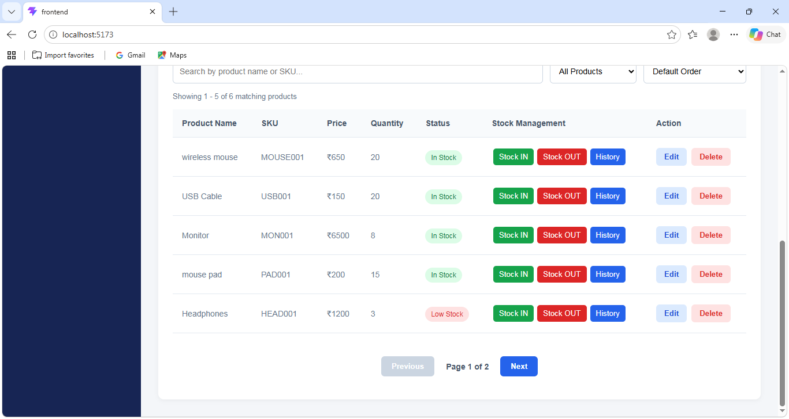

# Enterprise Inventory & Order Management System

A full-stack Inventory Management System built to manage products, monitor stock levels, and track inventory movements.

## Project Overview

The Enterprise Inventory & Order Management System is designed to simplify inventory operations through a web-based dashboard and RESTful APIs.

Users can manage products, update stock quantities, monitor low-stock products, and view stock movement history.

## Features

- Product management (Create, Read, Update, Delete)
- Stock IN and Stock OUT management
- Real-time stock quantity updates
- Stock movement history
- Low-stock alerts
- Product search and filtering
- Sorting and pagination
- REST API documentation with Swagger
- Database migrations using Alembic
- Backend API testing using Pytest

## Technology Stack

**Frontend**
- React.js
- JavaScript
- HTML5
- CSS3
- Vite

**Backend**
- Python
- FastAPI
- SQLAlchemy
- Pydantic

**Database**
- PostgreSQL

**Tools**
- Git & GitHub
- Postman
- Swagger UI
- Alembic
- Pytest

## Project Structure

```text
InventoryManagementSystem/
│
├── backend/
│   ├── alembic/
│   ├── tests/
│   ├── main.py
│   ├── database.py
│   ├── models.py
│   └── requirements.txt
│
├── docs/
│
├── frontend/
│   ├── public/
│   ├── src/
│   ├── package.json
│   └── vite.config.js
│
└── .gitignore
```

## Backend Setup

1. Navigate to the backend folder.
2. Create and activate a Python virtual environment.
3. Install dependencies:

```bash
pip install -r requirements.txt
```

4. Create a `.env` file inside the backend folder:

```env
DB_USER=postgres
DB_PASSWORD=your_password
DB_HOST=localhost
DB_PORT=5432
DB_NAME=inventory_management
```

5. Run database migrations:

```bash
alembic upgrade head
```

6. Start the backend server:

```bash
python -m uvicorn main:app --reload
```

Backend URL: http://127.0.0.1:8000

Swagger API Documentation: http://127.0.0.1:8000/docs

## Frontend Setup

Navigate to the frontend folder and install dependencies:

```bash
npm install
```

Start the development server:

```bash
npm run dev
```

Frontend URL: http://localhost:5173

## Run Backend Tests

From the backend folder:

```bash
python -m pytest -v
```

## Learning Outcomes

- Building RESTful APIs using FastAPI
- Connecting PostgreSQL with SQLAlchemy
- Implementing database migrations
- Developing frontend components using React
- Managing inventory transactions
- Writing automated backend tests
- Using Git and GitHub for version control

## Author

**Isha Raut**

GitHub: https://github.com/isha532

## Application Screenshots

### Dashboard


### Products & Stock Management

